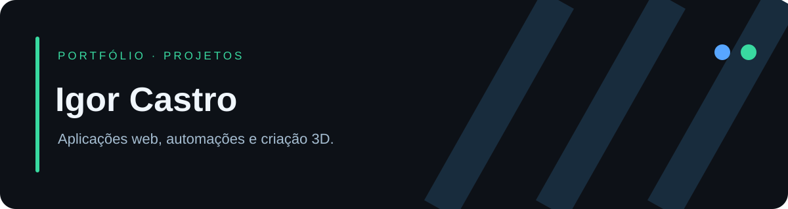

# Olá, eu sou Igor Castro

Desenvolvo aplicações web, automações e ferramentas de criação 3D. Meus projetos exploram soluções para operações, comércio e esporte.

## Aplicações web

As capturas abaixo mostram funcionalidades em ambientes locais com **dados fictícios**.

### ⚽ Racha Fortalaka

Inscrições, sorteio dos times, partidas e avaliações no futebol amador.

[**Ver projeto →**](https://github.com/igorcastro1010/fortalaka-racha) · [Acessar aplicativo ↗](https://fortalaka-racha.vercel.app)

### 🚚 Controle de Placas

Fila de carregamento, atualização em tempo real e histórico operacional.

[**Ver projeto →**](https://github.com/igorcastro1010/controle-de-placas-carregamento) · [Acessar aplicativo ↗](https://controle-de-placas-carregamento.vercel.app)

### 🛍️ VestLink

Catálogos digitais para lojas de roupas, com produtos e contato pelo WhatsApp.

[**Ver projeto →**](https://github.com/igorcastro1010/vestlink) · Demonstração em manutenção.

## Automação e criação 3D

| Projeto | Aplicação | Stack |
| --- | --- | --- |
| [🧩 Bambu AI Studio](https://github.com/igorcastro1010/bambu-ai-studio) | Criação e validação de peças 3D no Windows | Python · Qt · CAD |
| [🏀 NBA Injury Bot](https://github.com/igorcastro1010/nba-injury-bot) | Notícias de disponibilidade e análise estatística | Python · Telegram |
| [🌱 Irrigação com ESP32](https://github.com/igorcastro1010/esp32-irrigacao-inteligente) | Sensor de umidade e painel web local | ESP32 · Arduino |

## Estudos e documentação

[Mercado de frutas em C](https://github.com/igorcastro1010/Trabalho-Mercado) · [Documentação do VestLink](https://github.com/igorcastro1010/vestlink-context)

[**Explorar todos os repositórios →**](https://github.com/igorcastro1010?tab=repositories)
